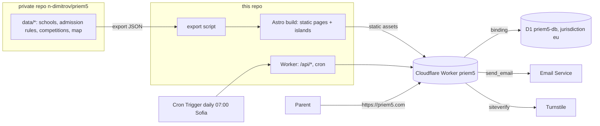

# Прием5 on Cloudflare: architecture

Status: proposal, 2026-10-17. Tracking: milestone "App v1 on Cloudflare" in this repo.

## Goals

- Public pages are static HTML, fast and indexable: the school directory (289 schools), school pages, admission guides, the competition calendar and matrix, glossary, sources, news.
- Two interactive tools run in the browser with no server: the map explorer and the score calculator.
- One small backend for email reminders before deadlines: sign-up, double opt-in, scheduled sends, unsubscribe.
- Free or close to it, one person to run, no servers.

## Shape

One Worker serves everything:

| Path | Served by | Notes |
|---|---|---|
| `/`, `/uchilishta/…`, `/sastezaniya/…`, `/priem/…`, `/rechnik/…` | Static assets | Built by Astro; free to serve |
| `/api/subscribe`, `/api/confirm`, `/api/unsubscribe`, `/api/preferences` | Worker code | `assets.run_worker_first: ["/api/*"]` |
| Daily reminders | Worker `scheduled()` handler | Cron Trigger |

## Products and why

| Need | Product | Why this one |
|---|---|---|
| Hosting static pages and API | **Workers + Static Assets** | Cloudflare's recommended path for new sites (Pages is for existing projects). Static requests are free. One deployable for pages, API and cron. |
| Build and deploy on push, PR previews | **Workers Builds** + **Previews** | Git-connected builds; a preview URL per branch replaces checking changes on the live site. |
| Subscribers and reminder state | **D1**, created with `--jurisdiction eu` | Small relational data (subscribers, topics, send log). EU jurisdiction keeps personal data in the EU for GDPR. Free plan: 5M row reads and 100k row writes per day, far above need. |
| Daily reminder run | **Cron Triggers** | Once a day, select due reminders, send them. Add **Queues** only if volume outgrows one invocation. |
| Sending email | **Email Service (Email Sending)** | Native `send_email` binding, DKIM/SPF set up on onboarding. **Requires Workers Paid ($5/month)**; 3,000 emails/month included, then $0.35 per 1,000. In public beta. |
| Contact address | **Email Routing** | `hello@priem5.com` forwards to the owner's inbox; free. Also the reply-to for reminders. |
| Bot protection on the sign-up form | **Turnstile** | Free, no cookie banner, server-side check in `/api/subscribe`. |
| Secrets (token signing key, Turnstile secret) | **Workers secrets** | Never in the repo. |
| Traffic stats | **Web Analytics** | Cookie-free, so no consent banner. |
| Errors and logs | **Workers Logs** | Built in; alert on failed cron runs. |
| DNS, TLS, redirects | **DNS, SSL/TLS, Redirect Rules** | Already on Cloudflare. `www` → apex with a Redirect Rule. |

Not needed now: KV, R2, Durable Objects, Workers AI, Queues, Access. Revisit if we add uploads, an admin UI, or search.

## Front end

- **Astro**, static output (`output: "static"`), with islands for the explorer map and the calculator. Reasons: content-heavy site, HTML by default (SEO), per-page JS only where needed, first-class Cloudflare support.
- Brand tokens from `brand/BRAND.md` as CSS custom properties; Montserrat from Google Fonts.
- Base map: `sofia-basemap.svg` inlined (81 KB), same projection as in the private repo.
- Every page: own title, description, canonical, OG image, JSON-LD (`School` / `EducationalOrganization` for school pages, `Event` for competitions).

## Data flow

1. Datasets live in the private repo under `data/` (milestone "Data foundation").
2. An export script turns them into `src/data/*.json` in this repo: only public facts, with `source_url` and `verified_on`.
3. A pull request carries each data update; CI validates against the JSON Schemas and builds.
4. Merge → Workers Builds deploys. Pages show "проверено към <date>" from the data.

Deadlines for reminders are part of the same export (`src/data/deadlines.json`), so the Worker and the pages read one source.

## Reminders

**Tables (D1):**
- `subscribers(id, email, created_at, confirmed_at, unsubscribed_at, consent_text_version, locale)`
- `subscriptions(subscriber_id, topic)`. Topics: `all`, `smg`, `npmg`, `competitions`, `private`, per-school slug.
- `sends(subscriber_id, deadline_id, sent_at, message_id, status)`, unique on `(subscriber_id, deadline_id)` so a rerun never double-sends.

**Flow:**
1. Form posts email + topics + Turnstile token to `/api/subscribe`. Rate-limited per IP.
2. Worker verifies Turnstile, stores an unconfirmed row and sends a confirmation email with a signed, expiring link.
3. `/api/confirm?t=…` sets `confirmed_at`. Nothing else is ever sent to unconfirmed addresses.
4. Cron, daily: for each deadline at T-14, T-3 and T-1 days, select confirmed subscribers of matching topics that have no `sends` row, and send.
5. Every email has a one-click unsubscribe link and `List-Unsubscribe` / `List-Unsubscribe-Post` headers. `/api/unsubscribe` sets `unsubscribed_at`; data is deleted after 30 days.

**Privacy:** store only the email, topics and timestamps. A privacy page explains purpose, retention and deletion. No tracking pixels.

## Environments

| | Production | Preview |
|---|---|---|
| URL | `https://priem5.com` | Workers Builds preview URL per branch |
| D1 | `priem5-db` (eu) | `priem5-db-preview` (eu) |
| Email | real sends | sends only to verified test addresses |
| Cron | on | off |

## Migration from GitHub Pages

1. Build and deploy the Worker; check it on its `workers.dev` and preview URLs.
2. Keep the coming-soon page as the Worker's home page until launch, so the switch changes hosting only.
3. Cut-over: delete the A/AAAA records for `priem5.com`, add the Worker Custom Domain `priem5.com` (Cloudflare creates the record and certificate). Replace the `www` CNAME with a proxied placeholder record and a Redirect Rule `www` → apex.
4. Verify, then disable GitHub Pages. Rollback: restore the A/AAAA records from `docs/RUNBOOK.md` in the private repo.

## Cost

| Item | Monthly |
|---|---|
| Workers Free: static assets, API, cron, D1, Turnstile, Web Analytics, Email Routing | $0 |
| Workers Paid, needed only for Email Sending | $5, includes 3,000 emails |
| Domain (Namecheap) | yearly fee, unchanged |

Turn on Workers Paid when reminders go live, not before.

## Open decisions

- Start on Workers Paid only when the reminder feature ships (recommended) or earlier for higher CPU limits during development.
- Keep this repo public (the site code and public data) — recommended — while private research stays in the private repo.
